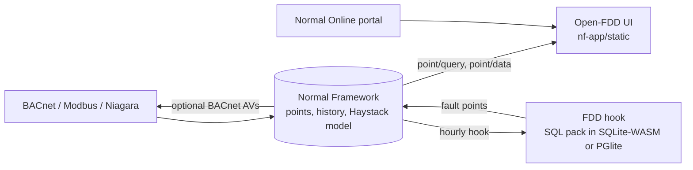

# Open-FDD

<p align="center">
  
</p>

<p align="center">
  <a href="https://github.com/bbartling/open-fdd/actions/workflows/nf-app-ci.yml"></a>
  <a href="https://github.com/bbartling/open-fdd/actions/workflows/parity.yml"></a>
  <a href="https://github.com/bbartling/open-fdd/actions/workflows/security.yml"></a>
</p>

<p align="center">
  <a href="https://bbartling.github.io/open-fdd/">
    
  </a>
  <a href="https://bbartling.github.io/open-fdd/rules/">
    
  </a>
  <a href="https://pypi.org/project/open-fdd/">
    
  </a>
  <a href="https://bbartling.github.io/open-fdd/install.html">
    
  </a>
  <a href="https://www.normal.dev/">
    
  </a>
  <a href="https://bbartling.github.io/open-fdd/architecture/adr-014-open-fdd-as-nf-plugin.html">
    
  </a>
</p>

**Open-FDD is free, open-source fault detection and diagnostics (FDD) and retro-commissioning (RCx) for HVAC,
shipped as a [Normal Framework](https://www.normal.dev/) (NF) app.** It runs inside NF on the building's edge
box and reads NF's Haystack model and point history directly, on the LAN or through the Normal Online portal.
Documentation: **[bbartling.github.io/open-fdd](https://bbartling.github.io/open-fdd/)** · Community: [Discord](https://discord.gg/qjT3w9y3pu).

- **FDD:** 77 SQL rules (AHU, VAV, chiller/plant, boiler, heat pump, meters, sensors) run hourly by an NF hook in
  SQLite-WASM or PGlite. Each result is an NF point tagged `fault`, `ruleRef`, `equipRef`: trended, queryable, in the RDF,
  and optionally served on NF's BACnet server.
- **Charts:** 60 RCx views (air handlers, zones/VAV, plant, weather, sensors, energy/M&V) plus a per-rule plot.
  Faults always show the same way: a 0/1 lane at the bottom of the plot.
- **Units:** FDD math is SI only; an imperial / SI toggle controls the display.
- **Export:** CSV download for Excel (Export tab); Haystack to RDF/Turtle with Brick time-series references, a
  browser SPARQL panel, and a SPARQL hook (`POST /api/v1/apps/open-fdd/hooks/sparql`, `args.query`, `args.format`).
- **No site code:** equipment, points and units are found by Haystack tags and NF classes. Model the site in NF;
  never fork the app per building.
- **Quality:** type-checked JavaScript (JSDoc + `tsc`), pandas == SQL parity tests, ZAP / npm audit / gitleaks in CI.



## Editions

| | **Open-FDD** (`nf-app/`) | **Open-FDD Lite** (`lite/`) |
|---|---|---|
| App id | `open-fdd` | `open-fdd-lite` |
| Box | 2 GB or more (SQLite engine); 4 GB or more for PGlite | 1 GB, such as a Raspberry Pi 3 |
| Tabs | Overview, Charts, FDD, RCx, Points, Export, BACnet Server, Model and RDF (SPARQL) | Overview, Charts, Points, BACnet Server, Model and RDF |
| Hooks | `fdd`, `weather`, `sparql` | `weather` (optional BACnet mirror) |
| Deploy | `python3 scripts/nf/hooks/nf_app_sync.py --env <console env> push nf-app/app.json` | `python3 scripts/nf/hooks/nf_app_sync.py --env <console env> push lite/app.json` |

Never run builds, tests or heavy engines on a small box; deploy from a PC.

## Quick start

**Try it on any PC, no NF box needed** (synthetic two-site building; every view draws):

```bash
node nf-app/dev/mock-nf.mjs
# open http://127.0.0.1:8765/api/v1/apps/static/open-fdd/
```

**Install on an NF box** (NF 3.10 or newer, console login): see [docs/install.md](docs/install.md).

**Test:**

```bash
node --test nf-app/tests/*.test.mjs lite/tests/*.test.mjs
(cd nf-app && npm ci && npm run typecheck)
python3 scripts/nf/build_rule_catalog.py --check && python3 scripts/nf/build_sql_pack.py --check
```

## Repository map

| Path | What |
|---|---|
| [`nf-app/`](nf-app/README.md) | **The full app.** Manifest, UI (`static/`), hooks (`hooks/`), rule packs (`rules/`), tests, mock NF (`dev/`) |
| [`lite/`](lite/README.md) | **Open-FDD Lite** for 1 GB boxes |
| [`sql/fdd/`](sql/fdd/README.md) | The FDD math: 77 Postgres SQL rules, registry, role map, tuning catalog; the packs are built from it |
| [`scripts/nf/`](scripts/nf) | Build the rule catalog and SQL packs, generate the rule docs, deploy (`hooks/nf_app_sync.py`) |
| [`deploy/nf-caddy/`](deploy/nf-caddy/README.md) | Optional Caddy front door: open dashboard, console and writes behind a login |
| [`tools/rdf-check/`](tools/rdf-check/README.md) | Turtle export checker (Oxigraph + rdflib) |
| [`open_fdd/`](open_fdd), [`tests/parity/`](tests/parity) | PyPI package (pandas reference rules) and the pandas == SQL parity tests |
| [`openfdd_agent_spec/`](openfdd_agent_spec/README.md), [`AGENTS.md`](AGENTS.md) | Spec and skills for AI coding agents (Claude Code, Cursor, Codex) |
| [`docs/`](docs) | The documentation site (GitHub Pages) and [ADR-014](docs/architecture/adr-014-open-fdd-as-nf-plugin.md) |

## PyPI package

```bash
pip install open-fdd
```

`open-fdd` is the pandas reference implementation of the rules plus tools for AI agents (reports, ECM workbooks). It is
for notebooks and parity checks, not the app's request path. Rule reference: [FDD rules](https://bbartling.github.io/open-fdd/fdd-rules.html).

<details>
<summary>💛 Support This Work</summary>

Support for Open-FDD directly funds the monthly time and labor required to keep the project moving forward, along
with professional application-security testing to keep it strong, robust, free, and secure.

<p align="center">
  <a href="https://paypal.me/benbartling20/25"></a>
  <a href="https://paypal.me/benbartling20/50"></a>
  <a href="https://paypal.me/benbartling20/250"></a>
  <a href="https://paypal.me/benbartling20"></a>
</p>

</details>

## License

MIT: see [LICENSE](LICENSE). The 4.x line (Rust central stack) is frozen at tag `v4.0.11-central` (branch `release/4.x`);
changes are in [CHANGELOG.md](CHANGELOG.md).
