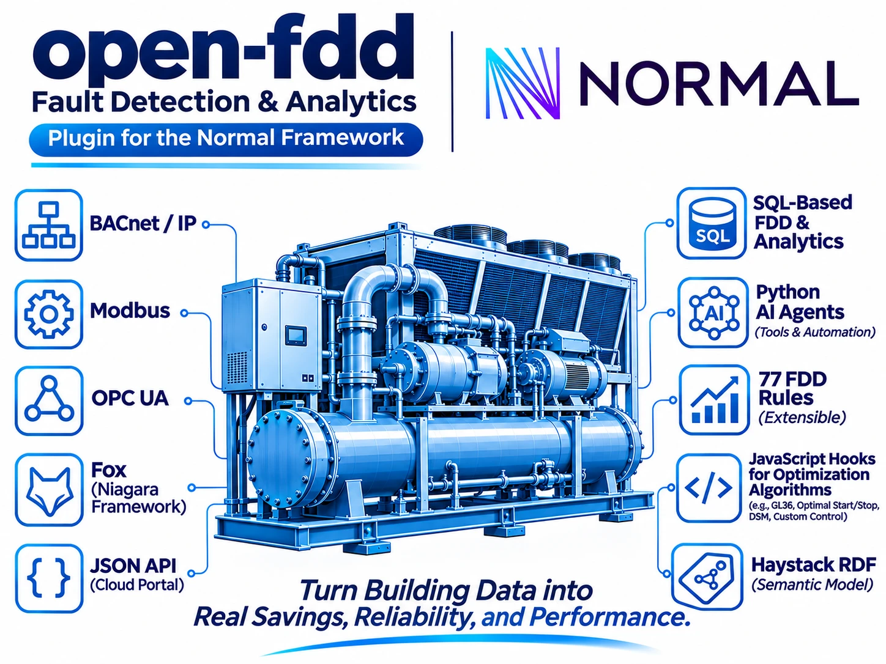

# Open-FDD

<p align="center">
  
</p>

<p align="center">
  <a href="https://github.com/bbartling/open-fdd/actions/workflows/nf-app-ci.yml"></a>
  <a href="#grok-bot-and-agent-skills"></a>
  <a href="https://github.com/bbartling/open-fdd/actions/workflows/security.yml"></a>
</p>

<p align="center">
  <a href="https://bbartling.github.io/open-fdd/">
    
  </a>
  <a href="https://bbartling.github.io/open-fdd/rules/">
    
  </a>
  <a href="https://pypi.org/project/open-fdd/">
    
  </a>
  <a href="https://bbartling.github.io/open-fdd/install.html">
    
  </a>
  <a href="https://www.normal.dev/">
    
  </a>
  <a href="https://bbartling.github.io/open-fdd/architecture/adr-014-open-fdd-as-nf-plugin.html">
    
  </a>
  <a href="#grok-bot-and-agent-skills">
    
  </a>
</p>

Open-FDD is open-source fault detection and diagnostics (FDD) and retro-commissioning (RCx) for HVAC,
packaged as a [Normal Framework](https://www.normal.dev/) app. It runs on the building's NF edge box, reads the
Haystack model and point history directly, and works on the local network or through the Normal Online portal.

- 77 SQL fault rules for air handlers, VAVs, plant, boilers, heat pumps, meters and sensors, run hourly inside NF.
  Results are written back as tagged NF points and can be served on NF's BACnet server.
- 60 retro-commissioning charts, CSV export, and an RDF model with a SPARQL query panel.
- All calculations in SI units; the display can be imperial or SI.
- No site-specific code: equipment and points are bound by Haystack tags and NF classes.

## Editions

| | Open-FDD (`nf-app/`) | Open-FDD Lite (`lite/`) |
|---|---|---|
| Hardware | 2 GB+ (TimescaleDB on larger hosts) | 1 GB, e.g. Raspberry Pi 3 |
| Includes | FDD engine, RCx charts, CSV export, SPARQL | Dashboard, charts, weather, BACnet mirror |
| Deploy | `python3 scripts/nf/hooks/nf_app_sync.py --env <env> push nf-app/app.json` | `... push lite/app.json` |

## Quick start

Try it without an NF box, using a synthetic two-site building:

```bash
node nf-app/dev/mock-nf.mjs
# open http://127.0.0.1:8765/api/v1/apps/static/open-fdd/
```

Install on an NF box (NF 3.10+): see the [install guide](https://bbartling.github.io/open-fdd/install.html) (editions, one-command install, upgrade, troubleshooting).
How API users read the results: [FDD data access](https://bbartling.github.io/open-fdd/fdd-data-access.html).

Run the tests:

```bash
node --test nf-app/tests/*.test.mjs lite/tests/*.test.mjs
(cd nf-app && npm ci && npm run typecheck)
python3 -m pytest tests -q
```

## Repository

| Path | Contents |
|---|---|
| [`nf-app/`](https://github.com/bbartling/open-fdd/blob/master/nf-app/README.md) | Full edition: UI, hooks, rule packs, tests, mock NF |
| [`lite/`](https://github.com/bbartling/open-fdd/blob/master/lite/README.md) | Lite edition |
| [`sql/fdd/`](https://github.com/bbartling/open-fdd/blob/master/sql/fdd/README.md) | Fault rules (SQL), registry, role scales, tuning catalog |
| [`open_fdd/`](https://github.com/bbartling/open-fdd/tree/master/open_fdd) | PyPI package: pandas reference rules and NF agent tools |
| [`scripts/nf/`](https://github.com/bbartling/open-fdd/tree/master/scripts/nf) | Build and deploy tooling |
| [`deploy/nf-caddy/`](https://github.com/bbartling/open-fdd/blob/master/deploy/nf-caddy/README.md) | Optional Caddy front door |
| [`docs/`](https://github.com/bbartling/open-fdd/tree/master/docs) | Documentation site |
| [`openfdd_agent_spec/`](https://github.com/bbartling/open-fdd/blob/master/openfdd_agent_spec/README.md) | Guidance for AI coding agents |

### FDD rules in SQL and pandas

The rules also run without NF: SQL on PostgreSQL / TimescaleDB, or pandas in Python. Imperial data (°F, inH₂O, cfm) is converted to SI first.

| | SQL (PostgreSQL / TimescaleDB) | pandas (Python, used for testing) |
|---|---|---|
| Rules | [`sql/fdd/postgres/rules/`](https://github.com/bbartling/open-fdd/tree/master/sql/fdd/postgres/rules), one file per rule | [`open_fdd/rules/`](https://github.com/bbartling/open-fdd/tree/master/open_fdd/rules), or `pip install open-fdd` |
| Cookbook | [SQL cookbook](https://bbartling.github.io/open-fdd/rules/sql-cookbook.html): each rule's inputs, SI parameters and full SQL | [pandas cookbook](https://bbartling.github.io/open-fdd/rules/pandas-cookbook.html): source plus a runnable example per rule |
| Thresholds | [`sql/fdd/tuning_catalog.json`](https://github.com/bbartling/open-fdd/blob/master/sql/fdd/tuning_catalog.json): defaults for every rule | SI defaults in each rule; any difference from SQL is listed in the parity report |

CI checks the two against each other; the [parity report](https://bbartling.github.io/open-fdd/rules/parity.html) explains each known difference.

## Grok Bot and agent skills

The [Open-FDD Grok Bot](https://x.ai/bot/COWOKNgQRUjlFqo6m0DY7) provides an agent template for working with the
project. Open the link to access the shared bot; availability and import controls depend on your account.
You can also use the repository skills directly with Claude, Codex or Cursor: start with [AGENTS.md](https://github.com/bbartling/open-fdd/blob/master/AGENTS.md).

The canonical recipes live in [openfdd_agent_spec/skills/](https://github.com/bbartling/open-fdd/tree/master/openfdd_agent_spec/skills/):

- Build: [charts](https://github.com/bbartling/open-fdd/blob/master/openfdd_agent_spec/skills/add-rcx-chart.md), [rules and tuning](https://github.com/bbartling/open-fdd/blob/master/openfdd_agent_spec/skills/add-or-tune-fdd-rule.md), [TypeScript checks](https://github.com/bbartling/open-fdd/blob/master/openfdd_agent_spec/skills/typescript.md).
- Operate: [site modeling](https://github.com/bbartling/open-fdd/blob/master/openfdd_agent_spec/skills/model-a-site-in-nf.md), [deployment](https://github.com/bbartling/open-fdd/blob/master/openfdd_agent_spec/skills/deploy-to-nf-box.md), [install/upgrade/troubleshooting](https://github.com/bbartling/open-fdd/blob/master/openfdd_agent_spec/skills/install-upgrade-troubleshoot.md), [NF gotchas](https://github.com/bbartling/open-fdd/blob/master/openfdd_agent_spec/skills/nf-gotchas.md).
- Validate: [security](https://github.com/bbartling/open-fdd/blob/master/openfdd_agent_spec/skills/security-checks.md), [BACnet](https://github.com/bbartling/open-fdd/blob/master/openfdd_agent_spec/skills/bacnet-validate.md), [ontology](https://github.com/bbartling/open-fdd/blob/master/openfdd_agent_spec/skills/audit-ontology-coverage.md).
- Python tools: [NF agent](https://github.com/bbartling/open-fdd/blob/master/openfdd_agent_spec/skills/pypi-nf-agent.md), [ML FDD](https://github.com/bbartling/open-fdd/blob/master/openfdd_agent_spec/skills/ml-fdd.md).

The `.agents/skills/` and `.claude/skills/` files are generated discovery pointers, not separate instructions.
After editing a canonical recipe, run `python scripts/check_skills_sync.py --write`; CI checks for drift,
including README cookbook counts and the NF version pin. The PyPI badge follows the published package version.

## AI agent tools (Python)

```bash
pip install open-fdd                          # ECM / ROI calculators and workbooks
pip install "open-fdd[anomaly,ml]"            # anomaly screening + ML detectors on CSV device folders (no NF needed)
pip install "open-fdd[nf]"                    # NF + SPARQL client, only when you read an NF box
```

Extras: `oracle` (pandas rules), `nf`, `analytics`, `anomaly`, `ml`, `ml-copod`, `ontology`, `ontology-shacl`, `reporting`, `rdf`, `duckdb`, `postgres`, `ecm-web`.

Python 3.11 or newer (3.11-3.14 tested, 3.14 is the default).
Commands: `open-fdd-nf`, `open-fdd-anomaly`, `open-fdd-ml`, `open-fdd-report`, `open-fdd-ecm`, `open-fdd-ontology-audit`, `open-fdd-version`.
Every tool with an example: [PyPI agent tools](https://bbartling.github.io/open-fdd/pypi-agent-tools.html).
The ML detectors are benchmarked on public LBNL AHU data: [results](https://github.com/bbartling/open-fdd/blob/master/docs/ml/lbnl-ahu-benchmark.md).
The anomaly and ML tools need no NF box or database: they read a device folder (`history_wide.csv` in SI +
`column_map.json`). Rule inputs are the ASHRAE 223P role names in `roles/openfdd-roles.json` (1.1.0-draft.1),
for example `discharge_air_temperature`. `open_fdd.point_roles` loads that file. Legacy keys (`sat`) still resolve.
The pandas reference also accepts the older hyphenated columns (`discharge-air-temp`).
`open-fdd-anomaly screen --engine sql --sql-engine duckdb` runs the z-score on DuckDB (`duckdb>=2.0.1`).
Timescale uses the same PostgreSQL statements on a connection that already has the core tables. The package (4.x) is versioned separately from the NF app (5.x).

## Support

<details>
<summary>Support this work</summary>

Donations fund ongoing development and independent security testing.

<p align="center">
  <a href="https://paypal.me/benbartling20/25"></a>
  <a href="https://paypal.me/benbartling20/50"></a>
  <a href="https://paypal.me/benbartling20/250"></a>
  <a href="https://paypal.me/benbartling20"></a>
</p>

</details>

Questions and discussion: [Discord](https://discord.gg/qjT3w9y3pu).

## License

MIT. See [LICENSE](https://github.com/bbartling/open-fdd/blob/master/LICENSE) and [CHANGELOG.md](https://github.com/bbartling/open-fdd/blob/master/CHANGELOG.md).
