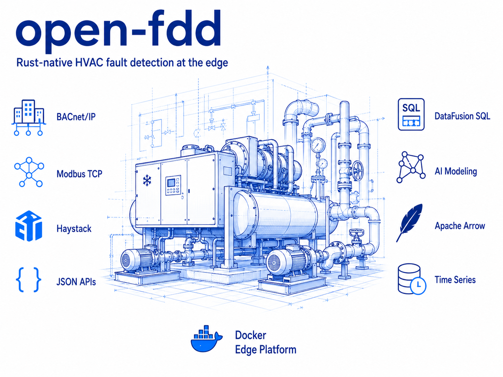

# Open-FDD

<p align="center">
  <a href="https://discord.gg/qjT3w9y3pu"></a>
  <a href="https://github.com/bbartling/open-fdd/actions/workflows/nf-app-ci.yml"></a>
  <a href="https://github.com/bbartling/open-fdd/actions/workflows/sql-pack-ci.yml"></a>
  
  
  
</p>

<p align="center">
  
</p>

**Open-FDD is free, open-source fault detection and diagnostics (FDD) and retro-commissioning (RCx) for HVAC,
shipped as a [Normal Framework](https://www.normal.dev/) (NF) app.** It runs inside NF on the building's edge
box, reads NF's Haystack model and point history directly, and runs the same 77-rule SQL pack everywhere — from
a small edge to a full IoT server, on the LAN or through the Normal Online portal.

- **FDD:** 77 SQL rules (AHU, VAV, chiller/plant, boiler, heat pump, meters, sensors) run hourly by an NF hook;
  each result is an NF point tagged `fault`, `ruleRef`, `equipRef` — trended, queryable, in the RDF, and
  optionally served on NF's BACnet server for the BAS front end.
- **Charts:** the full RCx library (60 views: air handlers, zones/VAV, plant, weather, sensors, energy/M&V) plus a
  per-rule plot. Faults always show the same way: a 0/1 lane at the bottom of the plot.
- **No site code:** equipment, points and units are found by Haystack tags and NF classes. Model the site in NF;
  never fork the app per building.
- **Model export:** Haystack → RDF/Turtle with external time-series references (Brick `ref:`), checked with
  Oxigraph + rdflib.


## Quick start

**Try it on any PC — no NF box needed** (synthetic two-site building, every view draws):

```bash
node nf-app/dev/mock-nf.mjs
# open http://127.0.0.1:8765/api/v1/apps/static/open-fdd/
```

**Install on an NF box** (NF ≥ 3.10, console login): see [docs/install/nf-plugin.md](docs/install/nf-plugin.md).

```bash
python3 scripts/nf/hooks/nf_app_sync.py --env ~/.secrets/nf_site_console.env push nf-app/app.json
```

**Test:**

```bash
node --test nf-app/tests/*.test.mjs
python3 scripts/nf/build_rule_catalog.py --check && python3 scripts/nf/build_sql_pack.py --check
```

## Profiles

| Profile | Box | FDD engine | Notes |
|---|---|---|---|
| edge-lite | ≥ 1 GB (2 GB+ recommended) | SQLite-WASM (sql.js, vendored, ~60 MB) | translated pack; 77/77 rules match Postgres in CI |
| full | ≥ 4 GB | PGlite (real Postgres in WASM, ~300 MB) | the pack exactly as written; `engine: "auto"` picks it |
| full + TimescaleDB | NF with the Timescale connector | in-database | planned — needs NF's connector schema ([status](docs/migration/nf-plugin/STATUS.md)) |

## Repository map

| Path | What |
|---|---|
| [`nf-app/`](nf-app/README.md) | **The product.** NF app manifest, UI (`static/`), hooks (`hooks/`), rule packs (`rules/`), tests, mock NF (`dev/`) |
| [`sql/fdd/`](sql/fdd/README.md) | The FDD math: 77 Postgres SQL rules, registry, role map, tuning catalog — the single source the packs are built from |
| [`scripts/nf/`](scripts/nf) | Build the rule catalog and SQL packs, deploy/sync the app (`hooks/nf_app_sync.py`) |
| [`deploy/nf-caddy/`](deploy/nf-caddy/README.md) | Optional Caddy front door: open dashboard, console and writes behind a login, HTTP or TLS |
| [`tools/rdf-check/`](tools/rdf-check) | Turtle export checker (Oxigraph + rdflib) |
| [`open_fdd/`](open_fdd) | PyPI package: pandas reference rules and report tools (notebooks, parity) |
| [`crates/`](crates) | Rust helpers kept for SQL contracts and DB bootstrap (`fdd_core`, `fdd_rules`, `fdd_tsdb`, `fdd_csv`) |
| [`tests/`](tests), [`scripts/qualification/`](scripts/qualification) | SQL pack qualification and parity suites |
| [`docs/`](docs) | Architecture ([ADR-014](docs/architecture/adr-014-open-fdd-as-nf-plugin.md)), migration [plan](docs/migration/nf-plugin/PLAN.md) / [status](docs/migration/nf-plugin/STATUS.md) / [NF features](docs/migration/nf-plugin/NF_FEATURES.md), install |
| [`archive/`](archive/README.md) | Retired code. `archive/central-v4/` = the Rust central stack (last release: tag `v4.0.11-central`) |

## PyPI package

```bash
pip install open-fdd
```

Reference library (`open_fdd.rules`) for notebooks and parity checks — not the app's request path. Rule catalog:
[Rule Cookbook](https://bbartling.github.io/open-fdd/rules/).

<details>
<summary>💛 Support This Work</summary>

Support for Open-FDD directly funds the monthly time and labor required to keep the project moving forward, along
with professional application-security testing to keep it strong, robust, free, and secure.

<p align="center">
  <a href="https://paypal.me/benbartling20/25"></a>
  <a href="https://paypal.me/benbartling20/50"></a>
  <a href="https://paypal.me/benbartling20/250"></a>
  <a href="https://paypal.me/benbartling20"></a>
</p>

</details>

## License

MIT — see [LICENSE](LICENSE). The pre-plugin 4.0 README is kept at
[archive/central-v4/README-open-fdd-4.0.md](archive/central-v4/README-open-fdd-4.0.md).
