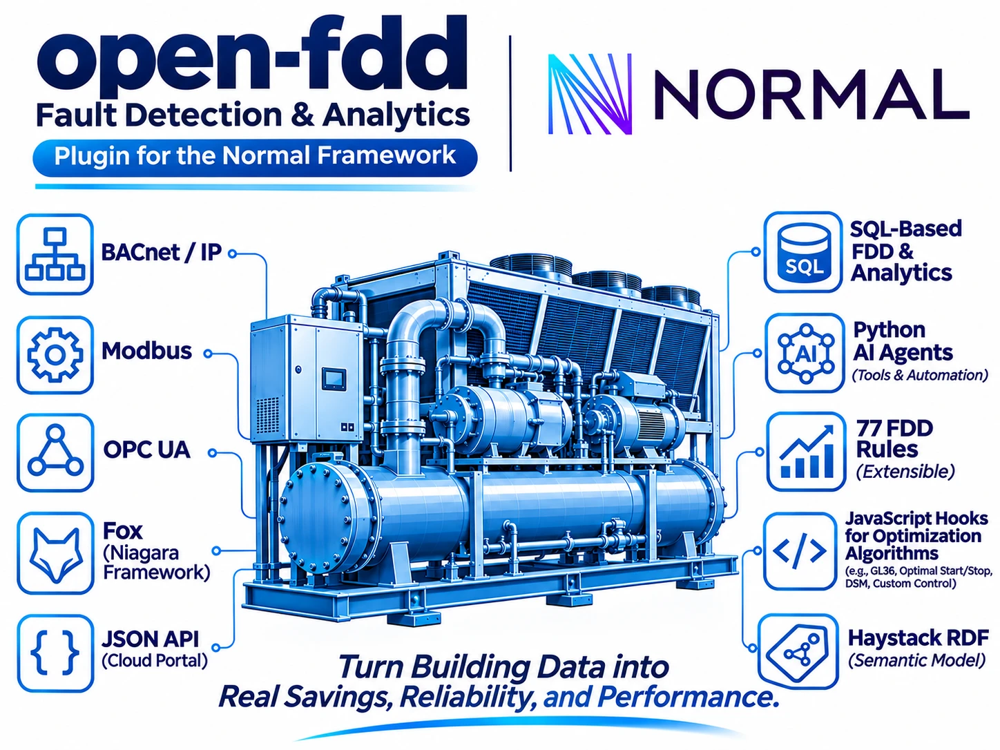

# Open-FDD

<p align="center">
  
</p>

<p align="center">
  <a href="https://github.com/bbartling/open-fdd/actions/workflows/nf-app-ci.yml"></a>
  <a href="https://x.ai/bot/COWOKNgQRUjlFqo6m0DY7"></a>
  <a href="https://github.com/bbartling/open-fdd/actions/workflows/security.yml"></a>
</p>

<p align="center">
  <a href="https://bbartling.github.io/open-fdd/">
    
  </a>
  <a href="https://bbartling.github.io/open-fdd/rules/">
    
  </a>
  <a href="https://pypi.org/project/open-fdd/">
    
  </a>
  <a href="https://bbartling.github.io/open-fdd/install.html">
    
  </a>
  <a href="https://www.normal.dev/">
    
  </a>
  <a href="https://bbartling.github.io/open-fdd/architecture/adr-014-open-fdd-as-nf-plugin.html">
    
  </a>
  <a href="https://x.ai/bot/COWOKNgQRUjlFqo6m0DY7">
    
  </a>
</p>

Open-FDD is open-source fault detection and diagnostics (FDD) and retro-commissioning (RCx) for HVAC,
packaged as a [Normal Framework](https://www.normal.dev/) app. It runs on the building's NF edge box, reads the
Haystack model and point history directly, and works on the local network or through the Normal Online portal.

- 77 SQL fault rules for air handlers, VAVs, plant, boilers, heat pumps, meters and sensors, run hourly inside NF.
  Results are written back as tagged NF points and can be served on NF's BACnet server.
- 60 retro-commissioning charts, CSV export, and an RDF model with a SPARQL query panel.
- All calculations in SI units; the display can be imperial or SI.
- No site-specific code: equipment and points are bound by Haystack tags and NF classes.

## Editions

| | Open-FDD (`nf-app/`) | Open-FDD Lite (`lite/`) |
|---|---|---|
| Hardware | 2 GB+ (4 GB+ for PGlite, TimescaleDB on larger hosts) | 1 GB, e.g. Raspberry Pi 3 |
| Includes | FDD engine, RCx charts, CSV export, SPARQL | Dashboard, charts, weather, BACnet mirror |
| Deploy | `python3 scripts/nf/hooks/nf_app_sync.py --env <env> push nf-app/app.json` | `... push lite/app.json` |

## Quick start

Try it without an NF box, using a synthetic two-site building:

```bash
node nf-app/dev/mock-nf.mjs
# open http://127.0.0.1:8765/api/v1/apps/static/open-fdd/
```

Install on an NF box (NF 3.10+): see the [install guide](https://bbartling.github.io/open-fdd/install.html) (editions, one-command install, upgrade, troubleshooting).
How API users read the results: [FDD data access](https://bbartling.github.io/open-fdd/fdd-data-access.html).

Run the tests:

```bash
node --test nf-app/tests/*.test.mjs lite/tests/*.test.mjs
(cd nf-app && npm ci && npm run typecheck)
python3 -m pytest tests -q
```

## Repository

| Path | Contents |
|---|---|
| [`nf-app/`](nf-app/README.md) | Full edition: UI, hooks, rule packs, tests, mock NF |
| [`lite/`](lite/README.md) | Lite edition |
| [`sql/fdd/`](sql/fdd/README.md) | Fault rules (SQL), registry, role scales, tuning catalog |
| [`open_fdd/`](open_fdd) | PyPI package: pandas reference rules and NF agent tools |
| [`scripts/nf/`](scripts/nf) | Build and deploy tooling |
| [`deploy/nf-caddy/`](deploy/nf-caddy/README.md) | Optional Caddy front door |
| [`docs/`](docs) | Documentation site |
| [`openfdd_agent_spec/`](openfdd_agent_spec/README.md) | Guidance for AI coding agents |

## Python package

```bash
pip install open-fdd
```

Pandas versions of the fault rules plus command-line tools for working with NF data, reports and ECM analysis.
The package is versioned separately from the NF app. See [Python tools](https://bbartling.github.io/open-fdd/python-tools.html).

## Support

<details>
<summary>Support this work</summary>

Donations fund ongoing development and independent security testing.

<p align="center">
  <a href="https://paypal.me/benbartling20/25"></a>
  <a href="https://paypal.me/benbartling20/50"></a>
  <a href="https://paypal.me/benbartling20/250"></a>
  <a href="https://paypal.me/benbartling20"></a>
</p>

</details>

Questions and discussion: [Discord](https://discord.gg/qjT3w9y3pu).

## License

MIT. See [LICENSE](LICENSE) and [CHANGELOG.md](CHANGELOG.md).
