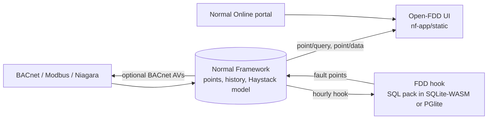

# Architecture

NF owns the field bus, the point model, history, auth, remote access and config backups. Open-FDD adds the UI, the
FDD hook (SQL rules in an embedded engine), the weather hook and a SPARQL hook. The decision and its consequences
are in [ADR-014](architecture/adr-014-open-fdd-as-nf-plugin.html); what the app uses from NF's platform is in
[NF features](migration/nf-plugin/NF_FEATURES.html).

## Principles

- **One source of FDD math**: `sql/fdd` builds the Postgres pack, and the SQLite pack is generated and checked for parity.
- **Nothing site-specific in code**: everything is discovered from NF's model.
- **SI math, display on top** ([Units](units.html)).
- **Light on the box**: NF resamples history; small boxes use the SQLite engine; heavy work never runs on the box.

## Migration records

Notes from the move from the 4.x central stack, kept for reference:
[Plan](migration/nf-plugin/PLAN.html), [Status](migration/nf-plugin/STATUS.html),
[NF features](migration/nf-plugin/NF_FEATURES.html), [Removed in 5.0](migration/nf-plugin/ARCHIVE_MAP.html).
