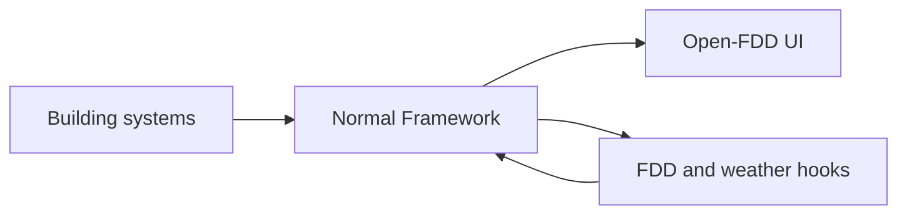

# Architecture

Open-FDD is a Normal Framework app. NF owns the model, point history, authentication, and field protocols. The app
provides a browser UI, scheduled hooks, and an FDD engine that runs within NF.

The Full app runs SQL rules through SQLite, PGlite, or an optional Timescale connector. Lite has no FDD engine. Both
editions use the NF model and history; neither adds a second historian or field-device write path.

For contributor details, start with AGENTS.md and the agent spec. The 4.x central-stack design is frozen at release
v4.0.11-central.
