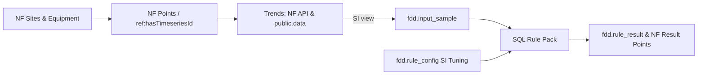

# API reference

Open-FDD uses the Normal Framework API. Results are ordinary NF points. This page describes generic read routes and
the Open-FDD result shape. Use the NF documentation for routes not listed here.

Set the base URL and credentials in a protected local environment.

```bash
export NF_URL='<reachable-console-base-url>'
export NF_CONSOLE_USER='<read-only-user>'
export NF_CONSOLE_PASSWORD='<secret>'
```

Use Basic auth for a local console, or the bearer token issued by the Normal Online portal. Portal API keys are
read-only. Hook invocation and app deployment may require console authentication. Always use TLS for remote access.

## Point metadata

### POST /api/v1/point/query

Query point metadata and current values. A query body selects a layer and uses structured query clauses:

```json
{
  "layer": "default",
  "pageSize": 500,
  "structuredQuery": {
    "and": [
      {"field": {"property": "markers", "text": "point"}},
      {"field": {"property": "markers", "text": "example-role"}}
    ]
  }
}
```

One marker is used per clause. Use the model layer for site, equipment, and device records. The default layer combines records
and exposes current values. The supported pager uses `pageOffset` with `totalCount`. It does not use a
`nextPageToken`. Open-FDD reads every page and rejects repeated records.

### GET /api/v1/equipment/classes

Returns the NF class vocabulary. The result can be paged. Query parameters accepted by the installed NF version are
authoritative. Open-FDD uses classes and Haystack markers to bind points to named roles. See the [data model](modeling.html).

## Point history

### GET /api/v1/point/data

Read resampled point history. Common query fields include repeated `uuids`, `from`, `to`, `window`, and
`method`. The response contains timestamps and values keyed by point id. Supported aggregation methods depend on
NF. Open-FDD uses averages for signals and maxima for fault timelines.

Use bounded requests. Batch point ids and split long ranges into time chunks. The app limits request URL size and
pages range reads where supported. A missing timestamp means no sample. It is not a zero. The NF API and the
[Python client](https://github.com/bbartling/open-fdd/blob/master/docs/python-tools.md) provide the response envelopes for your NF release.

## Open-FDD result points

The hourly Full FDD hook writes one equipment summary per rule and, for sensor sweeps, one row per assessed sensor.
Result points use fault or metric markers and carry attributes such as those below.

| Attribute | Meaning |
|---|---|
| `ruleRef`, `equipRef`, `siteRef` | Rule and modeled equipment/site ids |
| `fddStatus` | `fault`, `ok`, `not-assessed`, or `stale` |
| `fddReason` | Why a result is unknown or stale, when applicable |
| `fddCoverageHours` | Assessed time in the current window |
| `sensorRef`, `roleRef` | Sensor UUID and role on a per-sensor result |
| `fddSensorFaultHours` | Per-sensor hours included on the equipment summary |

With no coverage, status is not-assessed and there is no numeric fault value. Stale means the current run
could not refresh the point. It does not erase earlier history.

### Checking that results are fresh

Run `doctor` from the release checkout against the installed app. Its read-only **fdd freshness** check compares the
newest computed result with raw history and the configured FDD schedule. It fails when results are over twice the
schedule old while raw history is fresh. If raw history is also old, investigate the source or its polling first.
The check reports `fddStatus: stale` reasons. Read the latest FDD hook run with `include_results=true` for
per-equipment details. The Full Timescale edition's on-request `history` hook can report `newest_source_ts` for a
requested set of points, even when the selected range is empty.

### Query current fault status

Use point/query with clauses for the fault result markers. Read `attrs.fddStatus`, `attrs.ruleRef`,
`attrs.siteRef`, and `attrs.equipRef`. Treat `not-assessed` and `stale` as unknown, not healthy. The numeric
latest value is expressed in the point's declared unit. Fault percentage uses the 0–100 scale.

### Read fault timelines

Timeline points use the fault_timeline marker. Read them with point/query, then call point/data in bounded chunks.
The series records 1 when a fault is confirmed and 0 when assessed healthy. A missing timestamp is unknown. Use
`fddTimelineThrough` as a watermark when advancing a client-side cursor.

## Hook routes

NF exposes app hooks under `/api/v1/apps/{app-id}/hooks/{hook-name}`. POST to a hook route to start a run. Read
results from its `/runs?include_results=true` route. The browser/app uses the scheduled Full hooks for FDD and
weather. The SPARQL hook is on request. A successful HTTP response means NF accepted the run. Inspect run status and
results before treating it as complete.

## Schema ownership and data flow



| Owner | Relations | Role |
|---|---|---|
| Normal Framework | `public.instances`, `public.points`, `public.data` | Source model and native telemetry (`openfdd_rt` has `SELECT` only) |
| Open-FDD app | `fdd.point`, `fdd.rule_result`, `fdd.rule_config`, `openfdd.config` | Bound-point mirror, SI fault results, inline tuning revisions, scoped retention |
| Open-FDD adapter | `openfdd.nf_samples`, `fdd.input_sample` | Read-only `security_invoker` views converting native units to SI |

Full installations using Timescale store SI run results in `fdd.rule_result` (`sql/fdd/schema/core.sql`), while NF result points remain the primary API surface. Optional read-only SQL browsing (`pgweb` via `deploy/nf-caddy/docker-compose.pgweb.yml`) stays off by default on a private network behind Caddy TLS + auth using a `SELECT`-only role. See the [Timescale setup guide](https://github.com/bbartling/open-fdd/tree/master/nf-app/timescale).
