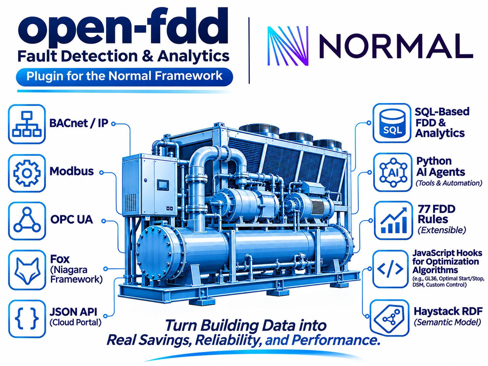

# Open-FDD

Open-FDD is free, open-source fault detection and diagnostics (FDD) and retro-commissioning (RCx) for HVAC.
Since 5.0 it is a **[Normal Framework](https://www.normal.dev/) (NF) app**: it runs inside NF on the building's
edge box, reads NF's Haystack model and point history directly, and needs no database, historian or login of its own.

- **77 SQL FDD rules** (air handlers, VAV, chillers and plants, boilers, heat pumps, meters, sensors), run hourly
  by an NF hook. Every result is an NF point, so it is trended, queryable and available to BACnet.
  See [FDD rules](fdd-rules.html).
- **RCx chart library**: plots for air handlers, zones, plants, weather, sensors and energy. Faults always show as
  a 0/1 lane at the bottom. See [Charts](charts.html).
- **No site code**: equipment, points and units are found from Haystack tags and NF point classes.
  Model the site in NF; never fork the app per building. See [Modeling](modeling.html).
- **Model export**: Haystack to RDF/Turtle with Brick time-series references, a browser SPARQL panel and a
  SPARQL hook. See [RDF and SPARQL](rdf-sparql.html).
- **CSV export** for Excel. See [Export](export.html).

> Screenshot placeholder: add `assets/screenshot-overview.png` (Overview tab) and `assets/screenshot-fdd.png`
> (FDD tab with a fault lane), then embed them here.

## Editions

| | **Open-FDD** (`nf-app/`) | **Open-FDD Lite** (`lite/`) |
|---|---|---|
| NF app id | `open-fdd` | `open-fdd-lite` |
| For | machines with real resources (about 2 GB or more) | 1 GB boxes such as a Raspberry Pi 3 |
| Tabs | Overview, Charts, FDD, RCx, Points, Export, BACnet Server, Model and RDF (with SPARQL) | Overview, Charts, Points, BACnet Server, Model and RDF |
| FDD engine | yes: SQLite-WASM or PGlite | none |
| Hooks | `fdd` (hourly), `weather`, `sparql` | `weather` |

Both can run on the same NF; on a small box run only Lite. See [Lite](lite.html).

## Where to go next

1. [Install](install.html): deploy to an NF box.
2. [Modeling](modeling.html): tag your site in NF so the rules and charts bind.
3. [Development](development.html): run it locally against the mock NF in one command.

Source: [github.com/bbartling/open-fdd](https://github.com/bbartling/open-fdd) (MIT). Community:
[Discord](https://discord.gg/qjT3w9y3pu). The 4.x line (Rust central stack) is frozen at tag
[`v4.0.11-central`](https://github.com/bbartling/open-fdd/tree/v4.0.11-central).
