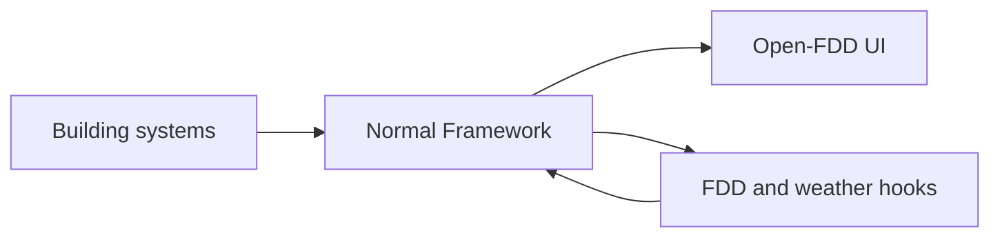

# Normal Framework

Open-FDD is an app for the [Normal Framework](https://docs.normal.dev/) (NF). NF owns the model, point history, field protocols (BACnet,
Modbus and others), authentication and remote access. Open-FDD adds a browser UI, scheduled hooks and, in Full, the FDD engine. It needs no
second login or historian. For anything about NF itself, use the [official NF documentation](https://docs.normal.dev/).



## Install

Pick an edition on [Lite vs Full](editions.html), then install from a workstation that can reach the NF console. The installer is Python 3
standard library only; NF runs the app.

```bash
python3 scripts/nf/hooks/nf_app_sync.py --env <protected-env-file> doctor nf-app/app.json
python3 scripts/nf/hooks/nf_app_sync.py --env <protected-env-file> install nf-app/app.json
```

Use `lite/app.json` for Lite. The env file sets `NF_CONSOLE_URL`, `CONSOLE_USERNAME` and `CONSOLE_PASSWORD`. Use the local console login: a
Normal Online API key is read-only and cannot install. `install` syncs files and hooks, restarts the app and verifies the hooks; it
refuses to overwrite hand-edited files without `--force`.

| Task | Where |
|---|---|
| Console-first install, TLS front door, Timescale schema check, timezone, troubleshooting | [Install reference](https://github.com/bbartling/open-fdd/blob/master/docs/install.md) |
| Upgrade the NF framework itself | NF release notes; [NF Compose guide](https://github.com/bbartling/open-fdd/blob/master/docs/operations/nf/nf-upgrade-compose.md) |
| Known NF behaviors | [NF gotchas](https://github.com/bbartling/open-fdd/blob/master/docs/operations/nf/nf-gotchas.md) |
| Validate BACnet mappings | [BACnet validation](https://github.com/bbartling/open-fdd/blob/master/docs/operations/nf/bacnet-validate.md) |

### Install methods

Four ways to put the app on NF. None needs SSH or Tailscale: each needs only the NF console over HTTP(S) and, for A, NF's own
reach to a git host.

| | Method | Needs | Status |
|---|---|---|---|
| A | **Git URL** (console **+Create**, or `POST /api/v1/apps`) | A repository whose root is the app: `python3 scripts/nf/build_app_dist.py --out build/dist` writes it (`app.json`, `hooks-update/`, `hooks/`, `static/`, `package.json`); push that folder to its own repo. NF needs outbound access to the git host and npm. | Not tested on NF |
| B | **`nf_app_sync.py`** (NF app API) | Any PC with Python 3 and HTTPS reach to the console, plus a console login. Remote access is whatever the site already has. | Tested, Full and Lite |
| C | **Single hook** (NF MCP `deploy_hook` / `manage_app write_file`) | The weather hook plus `hooks/lib/paging.js` and `hooks/lib/settings.js` (Lite is that one hook). Full's `fdd` hook needs its whole tree. | Not tested on NF |
| D | **Release zip** | The `open-fdd-lite-<version>.zip` / `open-fdd-<version>.zip` attached to each release (same tree as A), checksums in `SHA256SUMS`. IT unpacks it into an internal git repo and uses A, so the NF host needs no internet. | Zip built by CI; install not tested |

Repository subfolders do not work for A: NF reads `app.json` from the repository root and its docs name no subfolder or branch
field, so a clone of this repo (whose apps live in `nf-app/` and `lite/`) is not an app. For the IT department: send the zip, the
console URL, a console login for the integrator and, for Full, the Timescale connection (the `install.sql` step runs as the
database owner; see the install reference). Health checks need no SSH: `doctor` over the console API, the app's settings page and
the NF console hook runs. What was tested offline: the bundle contents against the manifest, byte for byte, and B on live sites. What needs a live
NF site: A, C and D (`docs/prompts/2026-11-12-install-methods-checklist.md`).

## Verify

- `doctor` reports a clean install and the expected engine state.
- Dashboard and charts load; Full shows current FDD results.
- RDF export has no dangling references ([data model](modeling.html)).
- The weather hook has coordinates from its app option or the modeled site.

## Upgrade, pin and remove

Run `doctor`, read the release notes, then run `install` from the exact release tag you intend to deploy. Pin each site to a reviewed
revision, not `master`. `install --remove-old` lists predecessor apps; add `--yes` to remove them. `uninstall` removes the current app and
keeps hook-created history. Back up NF before changing the host.

## Results and API

Results are ordinary NF points. See the [API reference](fdd-data-access.html) for point queries, results and history.

## Security

- Do not expose an unauthenticated NF console to the internet. Use the site LAN, a VPN or NF's portal with TLS, and never disable certificate checks.
- Keep credentials outside the repository. The optional Caddy front door protects the console and write routes
  ([`deploy/nf-caddy`](https://github.com/bbartling/open-fdd/tree/master/deploy/nf-caddy)).
- Open-FDD writes only its own result points and weather variables.
- The UI uses a strict Content Security Policy and local libraries. SPARQL rejects updates and remote `SERVICE`; CSV export escapes formula cells.
- Report vulnerabilities through GitHub private reporting: [SECURITY.md](https://github.com/bbartling/open-fdd/blob/master/SECURITY.md).
