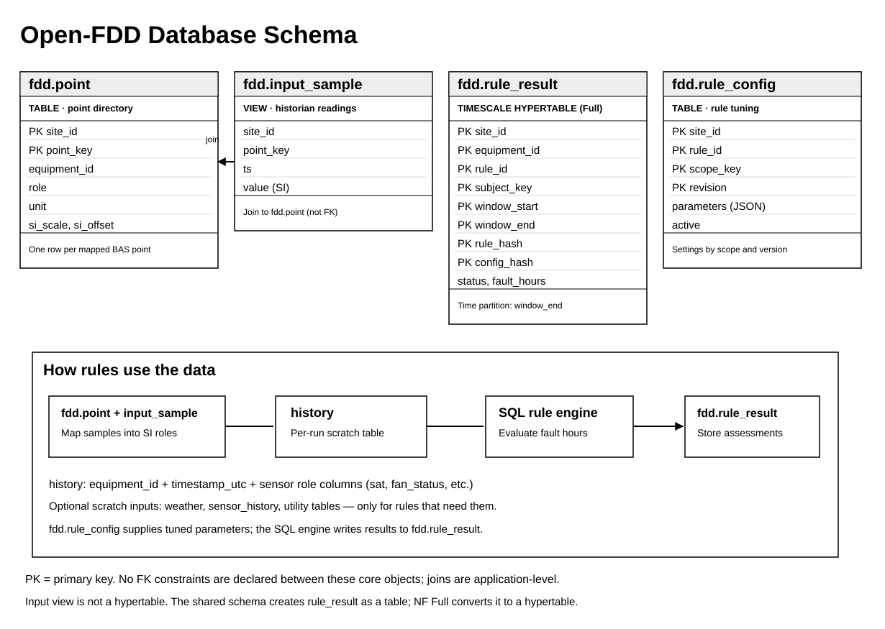

# Using SQL rules outside Open-FDD

The 77 rule SQL files are ordinary PostgreSQL 14+. They use no `time_bucket`, hypertables or continuous aggregates. Timescale is
only the runtime that builds the wide `history` input, so any database that can build that table can run them.

## Quick start (DuckDB, no server)

Checked on `generate(seed=0, equips=2, days=3, profile="basic")`: FC1, FC2 and CMD-1 match the pandas reference within 1e-6 h.
Run from a repo checkout (`pip install duckdb pandas numpy pyyaml`).

```python
import json, duckdb, pandas as pd
from open_fdd.parity import generate, reference

ds = generate(seed=0, equips=2, days=3, profile="basic")
data = ds.to_engine_input()
pack = json.load(open("nf-app/rules/pack-postgres.json"))   # rule SQL rendered at default parameters

hist = pd.DataFrame(data["history"])
hist["timestamp_utc"] = pd.to_datetime(hist.pop("ts"), unit="ms", utc=True)
con = duckdb.connect()
con.execute("SET TimeZone = 'UTC'")
con.register("hist_df", hist)
con.execute("CREATE TABLE history AS SELECT * FROM hist_df")

ref = reference(ds)
rows = con.execute(pack["rules"]["FC1"]["sql"]).fetchall()   # (equipment_id, fault_hours, covered_hours, fault_pct)
print(rows, {e: v["pandas"] for e, v in ref["FC1"].items()})
```

`open_fdd.parity` is missing from the older PyPI releases (4.5.4 and earlier). Until a later release is published, install from git: `pip install "open-fdd[oracle] @ git+https://github.com/bbartling/open-fdd"`.

## Runnable DuckDB and SPARQL tutorial

The [standalone DuckDB tutorial](https://github.com/bbartling/open-fdd/tree/master/tutorials/duckdb_sql_parity) includes executable pandas-versus-SQL assertions for FC1, FC2 and CMD-1, plus SPARQL point discovery joined to a DuckDB long-form historian. Both scripts run locally without an NF server. Follow its README for PowerShell or Linux setup.

## From CSV or a pandas DataFrame to a validated SQL rule

For a local, no-server walkthrough, use the [DuckDB tutorial README](https://github.com/bbartling/open-fdd/blob/master/tutorials/duckdb_sql_parity/README.md). From the repo root on Windows PowerShell:

```powershell
uv venv --python 3.12
uv pip install --python .venv/Scripts/python.exe -e ".[oracle]" duckdb rdflib matplotlib
.\\.venv\\Scripts\\python.exe tutorials/duckdb_sql_parity/explore_data.py
.\\.venv\\Scripts\\python.exe tutorials/duckdb_sql_parity/compare_rules.py
.\\.venv\\Scripts\\python.exe tutorials/duckdb_sql_parity/sparql_samples.py
```

- **Explore**: display DataFrame head, descriptive statistics, missing-value summary, and interactive Matplotlib plots (no PNG files written).
- **Compare**: generate one deterministic AHU dataset, load its history into an in-memory DuckDB `history` table, execute FC1/FC2/CMD-1 SQL extracted from `nf-app/rules/pack-postgres.json`, and independently execute `open_fdd.parity.reference(...)` for the pandas results. The script exits nonzero for missing or unequal fault-hour results (tolerance 1e-6 h).
- **Discover**: use RDFLib SPARQL over example point metadata and query the matching long-form samples with DuckDB.

**Important:** `pack-postgres.json` and `pack-sqlite.json` are **generated deployment artifacts**, not the SQL authoring source. To customize or add a rule, start with [Writing SQL rules](../sql-rules.html), edit `sql/fdd/postgres/rules/*.sql` and metadata, then regenerate and test the packs. DuckDB support varies by SQL dialect and PostgreSQL-only `fdd.*` functions.

## Setup by database

| Database | Rule SQL | Shims |
|---|---|---|
| PostgreSQL 14+ | `nf-app/rules/pack-postgres.json` or `sql/fdd/postgres/rules/*.sql` | Run `sql/fdd/postgres/postgres_helpers.sql` once (`fdd.try_double`, `fdd.mask_sweep_val` and the unit gates); `SET TimeZone = 'UTC'` |
| Timescale | same as PostgreSQL | same; Timescale only supplies `history` |
| DuckDB | the PostgreSQL pack | Define the `fdd.*` helpers as DuckDB macros (plpgsql does not parse); needed only by the occupancy and sensor-sweep rules; `SET TimeZone = 'UTC'` |
| SQLite | `nf-app/rules/pack-sqlite.json` | Built in; use the SQLite pack, not the PostgreSQL one |

`DATE_TRUNC('hour', timestamp_utc)` follows the session time zone, so always set UTC.

## Beginner's database guide: which tables do I actually need?



The diagram is drawn directly from `sql/fdd/schema/core.sql`, `sql/fdd/input_contract.json`, and the NF Full hypertable declaration in `nf-app/timescale/install.sql`. Boxes show **actual** keys, not assumed foreign-key constraints. `fdd.rule_result` is a Timescale hypertable **only after the Full edition installer converts it**.


**PK (primary key)** means the column(s) that uniquely identify a row. **FK (foreign key)** means a database-enforced link from one table to another. An *ordinary join* uses matching columns but is not necessarily an FK. Open-FDD's three core tables have **composite PKs** (more than one column), but **do not declare FK constraints** between them.

### Open-FDD Full (Normal Framework + TimescaleDB)

The [canonical core schema](https://github.com/bbartling/open-fdd/blob/master/sql/fdd/schema/core.sql) defines these **real persistent tables**, shared with other Open-FDD integrations. The source of historian samples is application-owned; it is **not** a fourth core table.

| Object | What it means in building terms | Primary key / relationship | When it is needed |
|---|---|---|---|
| `fdd.point` — table | Point directory: AHU SAT, fan status, duct static, etc., mapped to equipment, role, and SI units | **PK:** (`site_id`, `point_key`) | Full NF or an app managing point bindings |
| `fdd.input_sample` — **view**, not a core table | Reads timestamped historian values; columns `site_id`, `point_key`, `ts`, `value` | No declared PK/FK: join to `fdd.point` on (`site_id`, `point_key`) | Full NF or an adapter exposing samples |
| `fdd.rule_result` — table | Saves assessed rule windows, `PASS`/`FAULT` status, fault hours, and diagnostics | **PK:** (`site_id`, `equipment_id`, `rule_id`, `subject_key`, `window_start`, `window_end`, `rule_hash`, `config_hash`) | Persisting results in the Full edition |
| `fdd.rule_config` — table | Stores tuned settings and revision history | **PK:** (`site_id`, `rule_id`, `scope_key`, `revision`) | When you need saved settings |
| `history` — per-run scratch table | Wide, prepared readings: one equipment + UTC timestamp per row, one SI column per sensor role | Logical row identity: (`equipment_id`, `timestamp_utc`); see input contract, **not a declared persistent PK** | Running most equipment-based SQL rules |
| `weather`, `sensor_history`, utility tables — scratch inputs | Additional weather, sensor-sweep, or utility data | Rule-specific; see input contract | Only when the selected SQL rule uses them |

The Full edition builds its scratch inputs from the point directory and `fdd.input_sample` view, executes SQL, and writes results to `fdd.rule_result`. **Do not treat `result_id` as a unique PK or FK target:** the schema explicitly uses the composite result key, which also supports Timescale hypertables.

### Minimal setup outside Open-FDD

You do **not** need to install Normal Framework, reproduce the Full database, or create all of the core tables just to test a borrowed rule.

1. Pick a rule in the [SQL cookbook](sql-cookbook.html); note its **required roles** and any extra input tables.
2. Prepare a `history` table or DuckDB DataFrame with `equipment_id`, UTC `timestamp_utc`, and exactly the role columns the SQL references, using the canonical names and SI units in the [input contract](https://github.com/bbartling/open-fdd/blob/master/sql/fdd/input_contract.json).
3. Obtain the rendered SQL from `nf-app/rules/pack-postgres.json` (or the SQLite pack), execute it with the appropriate database dialect and any required helpers, and inspect `fault_hours` / `covered_hours`.
4. If a pandas twin exists, run the [parity comparison](parity-harness.html) on **the same input data** before relying on the rule in another application.

For example, the following is **illustrative** source data for a rule needing SAT readings; it is not a complete input for every rule:

```sql
-- Example historian input, not the canonical schema migration.
CREATE TABLE history (
    equipment_id TEXT NOT NULL,
    timestamp_utc TIMESTAMPTZ NOT NULL,
    sat DOUBLE PRECISION,
    PRIMARY KEY (equipment_id, timestamp_utc)
);
-- Example only: real rules may require several additional SI role columns.
```

The example PK is a **recommended local design choice**, not a PK defined for the generated Open-FDD scratch table. In production, keep one canonical point key per site, make timestamps unambiguous and UTC, de-duplicate history consistently, and never convert missing sensor values to zero. Convert native engineering units to SI before SQL rule execution.

### Simple relationship example

`fdd.point` holds a point such as `SAT-1` on `AHU-1`. A row in `fdd.input_sample` with the same (`site_id`, `point_key`) provides its reading and UTC timestamp. The loader maps its role (for example `sat`) into the wide `history` column. The rule calculates a fault result for `AHU-1`. The Full edition stores that finding in `fdd.rule_result`. These are **application-level joins and mappings**, not declared SQL foreign-key constraints.

## Input contract

Create the tables from `sql/fdd/input_contract.sql` (scratch DDL generated from `sql/fdd/input_contract.json`) and fill them yourself.

| Table | Content |
|---|---|
| `history` | One row per `equipment_id` and `timestamp_utc` (UTC), one `DOUBLE PRECISION` column per role |
| `weather` | As-of weather: `timestamp_utc`, `oa_t`, `web_oa_t`, `web_oa_dp` |
| `sensor_history` | Long form for the sensor sweeps: `equipment_id`, `series_id`, `sensor_role`, `unit`, `timestamp_utc`, `value` |
| `utility_interval`, `utility_monthly` | Only for the `UTIL-*` rules |

Values are SI: °C, Δ°C, Pa, L/s, kW, kWh; commands and positions 0-1; statuses 0/1; relative humidity 0-100 %RH. Rules never convert units
(see the [units convention](sql-cookbook.html#units-convention)).

## If the numbers do not match pandas

Most likely cause first.

| # | Check | Fix |
|---|---|---|
| 1 | Imperial instead of SI, or 0-100 instead of 0-1 fractions | Convert to SI before loading |
| 2 | Naive timestamps or a non-UTC session zone | Store `timestamptz` in UTC; `SET TimeZone = 'UTC'` |
| 3 | Contract column names (`duct_static`) vs Haystack names (`duct-static-pressure`) on the pandas side | Map with `sql/fdd/role_map.json` |
| 4 | `resample().mean()` instead of forward sample-and-hold | Hold each sample forward; a gap over 1 h is unknown |
| 5 | pandas startup holdoff of 600 s; SQL `startup_delay_min` defaults to 0 | Set the same delay on both sides |
| 6 | NULL handling vs `fillna(False)` | Keep unknown as unknown; compare on covered time |
| 7 | `fault_hours` denominator | It is eligible hold time, not calendar hours or a row count |
| 8 | Weather as-of window, duplicate timestamps, gate order | De-duplicate and sort first; `SV-RATE` uses a different algorithm (known divergence) |

Rules that differ on purpose are listed on the [parity](parity.html) page.

## Seeded data and pandas twins

`open_fdd.parity` generates the same SI dataset every time and runs the pandas twin of every rule. Use it as the oracle for your database.

| Call | Use |
|---|---|
| `generate(seed, equips, days, profile)` | Seeded SI history, weather and model; `content_hash()` is stable |
| `reference(ds)` | pandas fault hours per rule and equipment |
| `compare(rows, ref, Policy.default())` | Tolerance 1e-6 h plus the known-difference list |

Full API, profiles and the adapter interface: [parity harness](parity-harness.html). The [pandas cookbook](pandas-cookbook.html) lists every twin.
